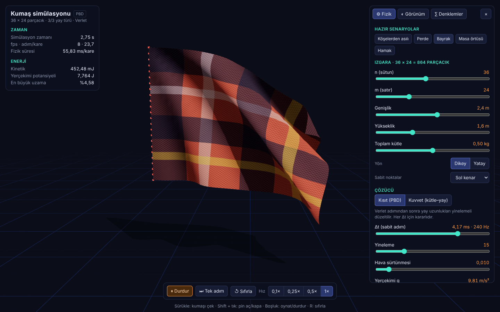
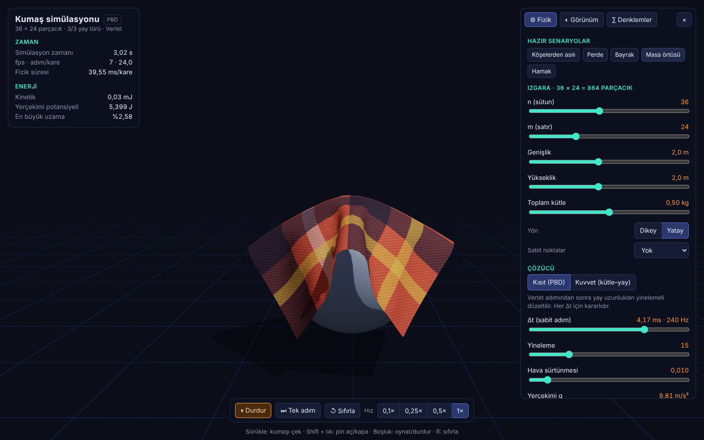
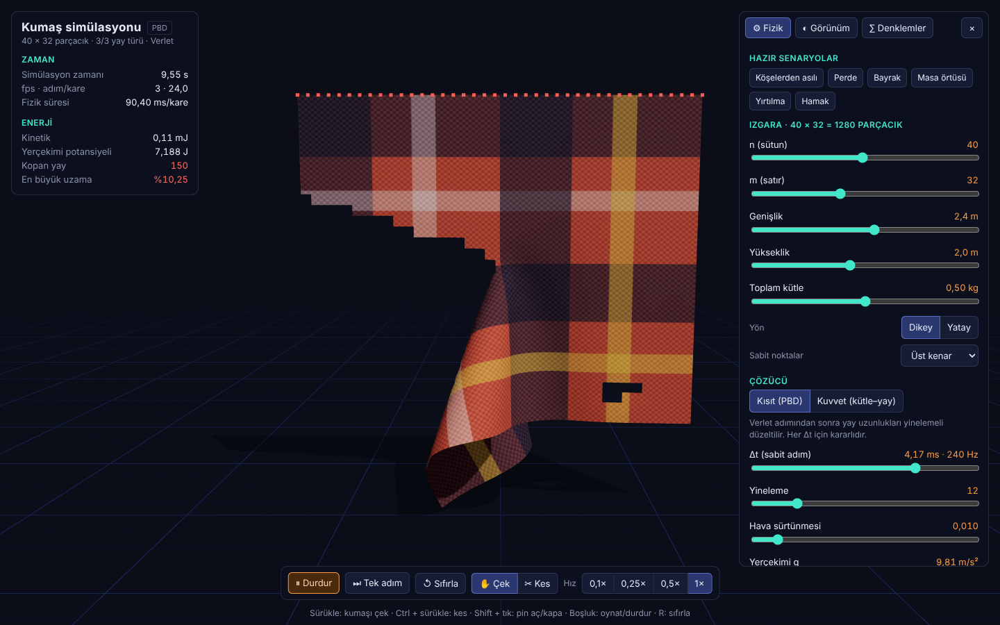

# r3f-mendil

<p align="center">
  <a href="https://billylz.github.io/r3f-medil/"></a>
</p>

<p align="center"><b>Demo:</b> <a href="https://billylz.github.io/r3f-medil/">https://billylz.github.io/r3f-medil/</a></p>

n × m parçacıktan oluşan dokulu bir kumaşın **kütle–yay modeli** ve **Verlet
entegrasyonu** ile gerçek zamanlı 3B simülasyonu (React Three Fiber).

## Demo

**▶ https://billylz.github.io/r3f-medil/**: tarayıcıda kurulum gerektirmeden çalışır. `main`'e her push'ta GitHub Actions ile otomatik güncellenir.







## Özellikler

- **Üç yay türü**, her biri ayrı açılıp kapanır ve ayarlanır:
  - **Structural**: yatay ve dikey komşular, gerilmeye direnç
  - **Shear**: çapraz komşular, kaymaya direnç
  - **Bending**: iki adım ötedeki komşular, bükülmeye direnç
- **Konum Verlet entegrasyonu**, sabit Δt ile; sonuç kare hızından bağımsız ve deterministik
- **İki çözücü:**
  - *Kısıt (PBD / Jakobsen)*: yay uzunlukları yinelemeli düzeltilir, her Δt için kararlı
  - *Kuvvet (kütle–yay)*: Hooke yayı + sönüm, klasik model. Kararlılık sınırı HUD'da gösterilir.
- **Kuvvetler ve çarpışma:** yerçekimi, üçgen başına aerodinamik rüzgâr ve dalgalanma, zemin ve küre çarpışması, sürtünme
- **Doku:** ekose, çizgili, kanvas, UV ızgarası, düz renk veya kendi yüklediğin görsel
- **Hata ayıklama katmanları:** parçacıklar (kırmızı: sabit), üç yay türü ayrı renklerde, gerilme renkleri, tel kafes
- **Yırtılma:** bağıl uzaması eşiği aşan yay kopar, kopan hücreler mesh'ten silinir ve yırtığın iki yakası tamamen ayrılır. Eşik panelden ayarlanır.
- **Etkileşim:** kumaşı fareyle sürükle (çekerek yırt), **Ctrl + sürükle** veya **✂ Kes** aracıyla bıçakla kes, **Shift + tık** ile nokta sabitle veya serbest bırak
- **Telefonla sallama:** telefonda **📱 Salla** düğmesine basıp telefonu salla; kumaş telefona tutturulmuş gibi savrulur (telefonun ivmesi kumaşa atalet kuvveti olarak etki eder). İsteğe bağlı **Eğim** modunda yerçekimi telefonun gerçek aşağı yönünü izler. iPhone'da önce hareket izni istenir.
- **Hazır senaryolar:** köşelerden asılı, perde, bayrak, masa örtüsü (küre üstüne), yırtılma, hamak
- KaTeX ile denklem paneli, enerji ve uzama göstergeleri

## Çalıştırma

```bash
npm install
npm run dev      # geliştirme sunucusu
npm test         # fizik testleri
npm run build    # üretim derlemesi (dist/)
```

Kısayollar: **Boşluk** oynat/durdur · **.** tek adım · **R** sıfırla

## Kod yapısı

```
src/physics/     # React'ten bağımsız, Node'da test edilen fizik çekirdeği
  grid.ts        # n × m parçacık ızgarası, pin'ler, üçgenler, UV
  springs.ts     # structural / shear / bending yay üretimi
  forces.ts      # Hooke + sönüm, rüzgâr
  constraints.ts # PBD mesafe kısıtı, zemin/küre çarpışması
  tearing.ts     # yırtılma: yay kopması, hücre silme, bıçak
src/motion.ts    # telefon hareket sensörü (DeviceMotion)
  ClothSim.ts    # Verlet adımı, sabit adım biriktiricisi, sürükleme, ölçümler
  presets.ts     # varsayılanlar ve hazır senaryolar
src/scene/       # R3F bileşenleri (kumaş mesh'i, yay çizgileri, parçacıklar, dokular)
src/ui/          # panel, HUD, denklemler, kontroller
scripts/check-cloth.ts  # fizik testleri
docs/kumas-plani.md     # araç planı ve yol haritası
```

## Testler

`npm test` şunları doğrular: yay sayıları formüllerle eşleşiyor; dinlenme
durumu korunuyor; serbest düşüş ½gt²; tek yay periyodu 2π√(m/k); enerji
sönümsüzde korunuyor, sönümlüde azalıyor; pin'ler sabit kalıyor; sonuç
deterministik; kumaş küreye ve zemine girmiyor; yırtılma kapalıyken hiçbir yay
kopmuyor, açıkken çekilen kumaş yırtılıyor; yırtık sonrası kalan her üçgen ve
bending yayı sağlam yaylara dayanıyor; ortadan kesilen kumaşın alt yarısı düşüyor.

## Yol haritası

Plan ve sonraki aşamalar (video/GLB kaydı, Web Worker) için:
[docs/kumas-plani.md](docs/kumas-plani.md)
